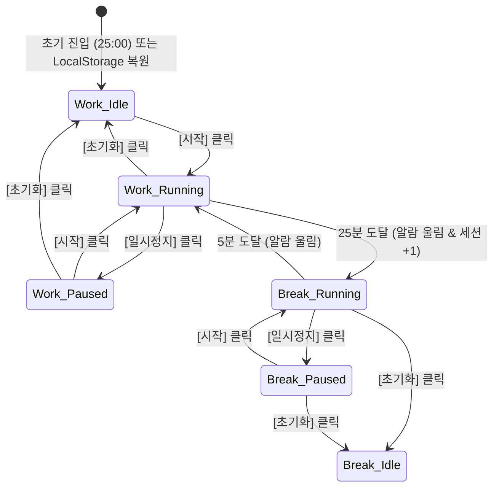

# 🍅 포모도로 타이머 웹 애플리케이션 기획 및 기능명세서

---

## 1. 프로젝트 개요 (Project Overview)

### 1.1 프로젝트 목적
본 프로젝트는 사용자가 작업과 휴식의 리듬을 체계적으로 관리하여 최상의 몰입감을 유지할 수 있도록 돕는 **반응형 웹 기반 포모도로 타이머**입니다.  
직관적인 원형 시각 피드백, 감성적인 테마 전환, 몰입을 돕는 백색소음(Ambient Sound)을 결합하여 단순한 타이머를 넘어 사용자의 작업 환경을 편안하게 조성하는 프리미엄 유저 경험을 제공합니다.

### 1.2 핵심 가치 (Core Values)
- **Deep Focus & Rest**: 25분 집중 / 5분 휴식의 과학적인 주기 자동 전환.
- **Visual Delight**: 우아한 원형 프로그레스 링, 글래스모피즘(Glassmorphism), 상태에 따라 숨 쉬듯 변화하는 부드러운 배경 테마.
- **Auditory Immersion**: 집중을 돕는 3종 백색소음(파도, 비, 새소리)과 전환 시점을 명확히 알려주는 차임 알람.
- **Seamless Multitasking**: 다른 작업을 하면서도 브라우저 탭 타이틀을 통해 남은 시간을 한눈에 파악.
- **State Persistence (영속화)**: 타이머 진행 상태와 남은 시간, 완료 세션 기록을 LocalStorage에 실시간 저장하여 브라우저 재방문 시 언제든 이전 상태 조회 및 복원.

### 1.3 기술 스택
| 영역 | 적용 기술 | 사유 |
| :--- | :--- | :--- |
| **구조 (HTML)** | Semantic HTML5 | 접근성, 명확한 문서 구조 및 SEO 최적화 |
| **스타일 (CSS)** | Modern Vanilla CSS | CSS 변수(Custom Properties), Flexbox/Grid, 트랜지션 & 키프레임 애니메이션 |
| **로직 (JS)** | Vanilla JavaScript (ES6+) | 가볍고 빠른 실행, 외부 의존성 없는 타임스탬프 기반 정밀 타이머 |
| **데이터 영속성** | LocalStorage API | 새로고침 및 재접속 시에도 타이머 잔여 시간, 세션 모드, 완료 카운트 복원 |
| **오디오 엔진** | Web Audio API / HTML5 Audio | 무중단 루프 백색소음 및 부드러운 볼륨/음소거 제어, 내장 합성음 알람 |
| **그래픽** | SVG (Scalable Vector Graphics) | 고해상도 디스플레이 대응 선명한 원형 프로그레스 링 |

---

## 2. 화면 구조 및 UI 와이어프레임 설계

```
+-------------------------------------------------------------+
|  [🍅 FocusFlow]                   [ 세션 완료: 🍅 0회 ]     | <- Header
+-------------------------------------------------------------+
|                                                             |
|                      +---------------+                      |
|                     /   [집중 모드]   \                     |
|                    |     24 : 59       |                    | <- Circular Ring &
|                     \  (원형 진행바)  /                     |    Central Timer
|                      +---------------+                      |
|                                                             |
|                [ ▶ 시작 ]  [ ⏸ 일시정지 ]  [ 🔄 초기화 ]       | <- Control Buttons
|                                                             |
+-------------------------------------------------------------+
|  백색소음 (Ambient Sound)                                    |
|  [ 🌊 파도 ]  [ 🌧️ 비 ]  [ 🐦 새소리 ]                      | <- Sound Chips
|  [ 🔊 ]  [=========o========] (60%)  [ 🔇 음소거 토글 ]        | <- Volume Slider
+-------------------------------------------------------------+
```

---

## 3. 세부 기능 명세서 (Functional Specification)

### 3.1 타이머 코어 엔진 (Timer Engine)
| ID | 기능명 | 세부 요구사항 | 예외/주의 사항 |
| :--- | :--- | :--- | :--- |
| **F-01** | 세션 자동 순환 | - **집중 모드**: 25분(1,500초)<br>- **휴식 모드**: 5분(300초)<br>- 집중 시간이 0초가 되면 알람 후 즉시 5분 휴식 모드로 자동 전환<br>- 휴식 시간이 0초가 되면 알람 후 즉시 25분 집중 모드로 자동 전환 | `setInterval` 오차 보정을 위해 `Date.now()` 기반 타임스탬프 차이 계산 로직 적용 |
| **F-02** | 타이머 제어 | - **시작(Start)**: 카운트다운 시작. 실행 중에는 시작 버튼 비활성화 또는 일시정지 버튼과 토글<br>- **일시정지(Pause)**: 현재 남은 시간 상태 그대로 멈춤<br>- **초기화(Reset)**: 현재 모드의 최초 설정값(25분 또는 5분)으로 시간 복구 및 일시정지 상태로 전환 | 일시정지 후 재시작 시 잔여 시간부터 자연스럽게 재개 |
| **F-03** | 탭 타이틀 연동 및 상태 영속화 (LocalStorage) | - **탭 제목 실시간 연동**: 브라우저 탭 제목(Title)에 실시간 남은 시간 및 모드 표시<br>  - 집중 시: `(24:59) 🎯 집중 중 - FocusFlow`<br>  - 휴식 시: `(04:59) ☕ 휴식 중 - FocusFlow`<br>  - 일시정지 시: `(일시정지) 24:59 - FocusFlow`<br>- **LocalStorage 실시간 저장**: 현재 모드(집중/휴식), 남은 시간(초), 동작 상태(실행/일시정지), 마지막 업데이트 타임스탬프를 실시간으로 브라우저 로컬 저장소에 저장<br>- **재방문 시 조회 및 복원**: 사용자가 브라우저를 닫거나 새로고침 후 재방문했을 때 `localStorage` 데이터를 조회하여 중단되었던 모드와 남은 시간을 그대로 복원 | 탭이 백그라운드에 있거나 브라우저 재실행 시에도 끊김 없이 이전 진행 상태를 유지할 수 있도록 안전한 직렬화/파싱 처리 |

---

### 3.2 시각적 표현 및 테마 (Visuals & Dynamic Themes)
| ID | 기능명 | 세부 요구사항 | 디자인 토큰/효과 |
| :--- | :--- | :--- | :--- |
| **F-04** | 원형 진행 링 (Circular Progress Ring) | - 화면 중앙에 SVG `circle`로 제작된 대형 프로그레스 링 배치<br>- 경과된 시간에 따라 부드럽게 링이 줄어들거나 채워짐 (`stroke-dasharray`, `stroke-dashoffset` 활용)<br>- 링 중앙에 큰 폰트(Monospace/Tabular 숫자)로 `MM:SS` 표시 | 진행 링 테두리에 부드러운 네온 글로우(Drop-shadow/Glow) 효과 적용 |
| **F-05** | 모드별 다이내믹 배경 테마 | - **집중 모드**: 차분하고 깊이감 있는 웜 톤 (딥 테라코타/다크 코랄/따뜻한 앰버)<br>- **휴식 모드**: 편안하고 안정감을 주는 쿨 톤 (세이지 그린/에메랄드 포레스트/소프트 민트)<br>- 모드 전환 시 CSS `transition: background 1.2s ease`로 자연스러운 색감 변화 연출 | 눈의 피로를 최소화하는 정밀한 다크-앰비언트 그라데이션 적용 |
| **F-06** | 버튼 인터랙션 (Micro-Interactions) | - 모든 액션 버튼은 둥근 모서리(Border-radius: 9999px 또는 16px)<br>- **Hover 효과**: 부드러운 확대(`scale(1.05)`), 백라이트 그림자 증가, 색상 명도 전환 (Transition: 0.25s ease)<br>- **Active/Click 효과**: 살짝 눌리는 입체감(`scale(0.96)`) | 키보드 접근성(Tab 포커스 링) 지원 |

---

### 3.3 백색소음 & 알림 시스템 (Audio Engine)
| ID | 기능명 | 세부 요구사항 | 세부 구현 방식 |
| :--- | :--- | :--- | :--- |
| **F-07** | 3종 백색소음 선택 | - 파도(Ocean Waves), 비(Rain), 새소리(Birds) 3가지 옵션 제공<br>- 칩(Chip) 버튼 형태로 클릭 시 선택/해제 토글<br>- 한 번에 하나의 사운드 재생 (자연스러운 크로스페이드 페이드인/아웃 지원) | 끊김 없는 무한 루프(`loop=true`) 재생, 네트워크 단절 시에도 구동 가능한 오디오 소스 또는 Web Audio 화이트노이즈 신디사이저 |
| **F-08** | 볼륨 제어 및 음소거 | - 부드러운 슬라이더(Range Input)로 0% ~ 100% 볼륨 조절<br>- 음소거 토글 버튼: 클릭 시 현재 볼륨 기억 후 0으로 전환, 재클릭 시 기존 볼륨 복원<br>- 볼륨 상태에 따른 아이콘 동적 변경 (🔊 높은 볼륨 / 🔉 낮은 볼륨 / 🔇 음소거) | Web Audio `GainNode` 또는 `audio.volume` 연동 |
| **F-09** | 세션 종료 알림음 (Alarm Chime) | - 25분 집중 종료 시: 달성감을 주는 밝고 청명한 벨소리<br>- 5분 휴식 종료 시: 다시 시작을 부드럽게 알리는 차임벨<br>- 브라우저 오디오 자동 재생 정책(Autoplay Policy)을 고려하여 첫 시작 인터랙션 시 오디오 컨텍스트 사전 언락 | 오디오 파일 누락 위험을 방지하기 위해 Web Audio API 오실레이터(Oscillator) 기반 크리스탈 차임 사운드 내장 |

---

### 3.4 세션 통계 및 상태 보존 (Session Counter)
| ID | 기능명 | 세부 요구사항 | 비고 |
| :--- | :--- | :--- | :--- |
| **F-10** | 세션 완료 카운터 | - 집중 25분을 완전히 완료했을 때만 세션 카운트 +1 증가 (휴식 세션은 카운트하지 않음)<br>- 헤더 또는 타이머 하단에 `완료한 뽀모도로: 🍅 x N` 형식으로 시각화<br>- 브라우저 새로고침 시에도 유지되도록 `localStorage` 동기화 지원<br>- 카운트 리셋 기능 제공 | 목표 달성 시 시각적 축하 애니메이션(스파클/바운스) |

---

## 4. 상태 전이 다이어그램 (State Transition)



---

## 5. 단계별 개발 계획 (Next Step Roadmap)

1. **Step 1: UI 마크업 및 디자인 시스템 구축**
   - 글래스모피즘 컨테이너 및 반응형 레이아웃
   - 집중 모드 / 휴식 모드 CSS 변수 및 다이내믹 컬러 팔레트 선언
   - 원형 SVG 프로그레스 링 및 모던 폰트 타이포그래피 세팅
2. **Step 2: 정밀 타이머 로직 및 상태 관리 (LocalStorage 연동)**
   - 25분/5분 카운트다운 타이머 엔진 (드리프트 방지)
   - 세션 카운터 및 잔여 시간 `localStorage` 실시간 영속화 & 재방문 복원
   - 브라우저 탭 실시간 Title 동기화
3. **Step 3: 오디오 엔진 (Web Audio & Ambient Sound)**
   - 파도/비/새소리 백색소음 플레이어 & 볼륨/음소거 인터페이스
   - Web Audio API 기반 청명한 알람 차임벨 구현
4. **Step 4: 인터랙션 완성 및 브라우저 검증**
   - 마우스 호버/액티브 마이크로 애니메이션 최적화
   - 자동 전환, LocalStorage 복원 및 알람 소리 브라우저 테스트 및 최종 완성
